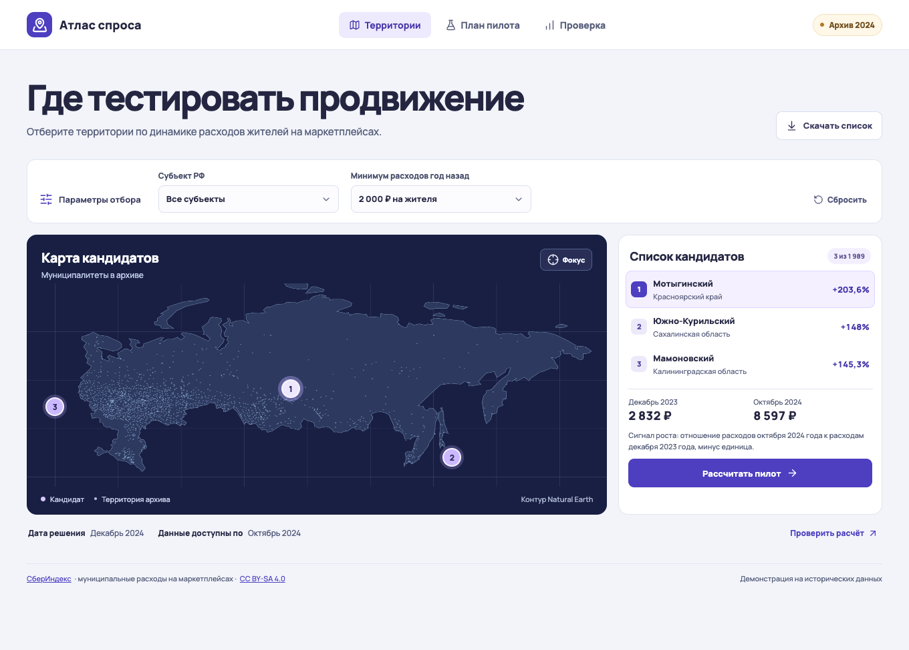

# Выбор территорий для продвижения на маркетплейсе

Стипендиальный проект для номинации «Технологии электронной коммерции». Помогает составить короткий список территорий, в которых продавцу стоит проверить возможность пробного продвижения.

[Открыть «Атлас спроса» в браузере](https://nikitameshds.github.io/marketplace-growth-atlas/demo.html) · [Скачать автономное демо](https://raw.githubusercontent.com/NikitaMeshDS/marketplace-growth-atlas/main/demo.html) · [Сценарий проверки с продавцом](docs/seller-review.md) · [Портфолио автора](docs/portfolio.md)



Приложение показывает интерактивную карту, кандидатов и учебный расчёт экономики пилота. Демо работает на муниципальном архиве 2023–2024 годов и запускается офлайн из одного файла.

## Один сценарий

Выберите Красноярский край и порог 2 000 ₽ на жителя год назад. Список содержит три кандидата из 51. Откройте расчёт пилота для Мотыгинского. При учебном бюджете 6 000 ₽ и марже 300 ₽ 20 дополнительных выкупленных заказов покрывают бюджет, 21 заказ даёт положительную прибыль. В разделе «Проверка» можно сверить результаты на архиве и сравнение с базовыми правилами.

В разделе «План пилота» можно указать статус кандидата и причину решения, отметить доставку, наличие товара и зону показа. Записи привязаны к муниципалитету и сохраняются в текущем браузере. Кнопка «Скачать список» на карте и в плане пилота выгружает текущую тройку с решениями и результатами проверок.

[Открыть расчёт для Мотыгинского](https://nikitameshds.github.io/marketplace-growth-atlas/demo.html#section=pilot&region=%D0%9A%D1%80%D0%B0%D1%81%D0%BD%D0%BE%D1%8F%D1%80%D1%81%D0%BA%D0%B8%D0%B9+%D0%BA%D1%80%D0%B0%D0%B9&candidate=708) · [Открыть региональную проверку](https://nikitameshds.github.io/marketplace-growth-atlas/demo.html#section=review)

Кнопка «Скопировать ссылку» сохраняет в адресе экран и его параметры. Решения по кандидатам, заметки, бюджет и маржа хранятся вне ссылки.

## Что проверили

Архив СберИндекса содержит оценки месячных безналичных расходов жителей по категории «Маркетплейсы». Сравнение использует восемь целевых месяцев 2024 года. Территория включается при наличии 15 положительных месячных наблюдений до даты отсечения. В основном сценарии к началу целевого месяца наблюдается история по предпоследний завершённый месяц. В дополнительном сценарии доступен предыдущий месяц. Фактическая задержка публикации и исторические версии выгрузки неизвестны.

Для декабрьского решения пять методов сравниваются на фактах мая–октября, которые уже доступны при заданном лаге. Ноябрь исключён из выбора метода. Правило отбора использует максимальный средний процентиль тройки по фактическому годовому росту. Метод прогноза суммы выбирается по минимальной средней MAE. По обоим критериям в мае–октябре победил перенос последнего доступного уровня. Декабрь оценивался отдельно для этого протокола. Панель 2024 года ранее использовалась в исходном исследовании.

- В декабре выбраны Богородский, Ульчский и Верхневилюйский муниципалитеты. Все три вошли в фактическую тройку по **номинальному годовому росту** среди 2 026 территорий с известным итогом из 2 027 допущенных.
- Простое ранжирование по минимальной прошлогодней базе дало в декабре два совпадения. На периоде выбора оба правила дали по 11 совпадений из 18. За восемь месяцев без порога методы дали 16 и 15 совпадений из 24, а без лага оба дали по 15. При пороге 2 000 ₽ декабрьский список меняется полностью.
- Для декабрьской суммы перенос последнего годового темпа дал MAE 586 ₽ на жителя, а выбранный по предыдущим месяцам метод — 1 566 ₽. За восемь месяцев значения составили 500 ₽ и 603 ₽ соответственно, на 16 197 одинаковых парах «территория — месяц». Это ретроспективное сопоставление.
- При одинаковом пороге 2 000 ₽ и на пяти месяцах с полными результатами всех трёх правил получено 11/15 совпадений для относительного сигнала, 1/15 для низкой базы и 6/15 для прироста в рублях. Пороги исследовательские. По каждому порогу рейтинг и фактическая тройка пересчитаны внутри общего пула.
- Коммерческий пилот сравнивает привычный отбор продавца с тем же процессом, дополненным сигналом, при равном бюджете. Для него нужны свежий сопоставимый архив, данные продавца и доступная география продвижения. Исходный показатель — расходы на жителя в агрегированной категории «Маркетплейсы» СберИндекса.

### Помесячный перевыбор метода

С сентября по декабрь сравниваем методы заново перед каждым решением. Для выбора используем только месяцы с исходами, доступными по сценарию лага в один месяц. Начальное окно содержит три месяца оценки. Первый результат для списка: 9 попаданий из 12 против 8 у минимальной базы. Для суммы перевыбор дал 881 ₽ средней абсолютной ошибки, а фиксированный перенос последнего годового темпа на тех же датах — 651 ₽. Четыре среза относятся к ретроспективному архиву. [Помесячные результаты](evidence/walk-forward.csv)

### Проверка сценария в Красноярском крае

Сценарий из демо проверен за май–декабрь 2024 года с порогом 2 000 ₽ на жителя. В каждом месяце три правила сравнивались в одном допустимом пуле из 44–51 муниципалитета. Исходы известны для всего пула. Сигнал роста дал 13 попаданий из 24 в региональную тройку по фактическому годовому росту, прирост в рублях — 9, низкая прошлогодняя база — 7. В декабре каждое правило дало 2 из 3. Это результат одного региона на архивных данных. [Помесячные результаты](evidence/krasnoyarsk-backtest.csv)

### Проверка по субъектам РФ

В разделе «Проверка» демо можно сравнить пять правил при четырёх порогах и переключиться на одни и те же региональные срезы для всех порогов. Данные для этого экрана встроены в автономную сборку.

За май–декабрь 2024 года повторили отбор по всем 85 субъектам справочника со стабильной принадлежностью муниципалитетов в 2023 и 2024 годах. Для каждого субъекта и месяца сравнили пять правил отбора при едином пороге 2 000 ₽ на жителя год назад. Последний годовой темп переносит рост последнего видимого месяца к тому же месяцу годом ранее. Сглаженный темп опирается на три последних таких отношения и общий рыночный ориентир. Срез участвует в сравнении при наличии от 10 кандидатов и известных итогов у всего пула. Из 680 срезов сравнили 432 в 64 субъектах. В 241 срезе пул оказался меньше десяти, а в семи отсутствовали итоги.

| Правило | 432 сопоставимых среза | 42 субъекта с восемью сопоставимыми месяцами |
|---|---:|---:|
| Сигнал роста | 743 из 1 296 (57,3%) | 572 из 1 008 |
| Прирост в рублях | 553 из 1 296 (42,7%) | 414 из 1 008 |
| Низкая прошлогодняя база | 557 из 1 296 (43,0%) | 438 из 1 008 |
| Последний годовой темп | 551 из 1 296 (42,5%) | 422 из 1 008 |
| Сглаженный темп | 547 из 1 296 (42,2%) | 425 из 1 008 |

По сумме внутри субъекта сигнал опередил прирост в рублях в 55 субъектах, сравнялся в шести и уступил в трёх. В Кемеровской области прирост дал 16 попаданий, сигнал — 15 из 24. Низкой базе сигнал уступил в 11 субъектах, последнему годовому темпу — в семи. Соседние месяцы и муниципалитеты повторяются. Результат характеризует качество отбора на архиве при выбранном пороге. [Данные по всем срезам](evidence/regional-coverage.csv)

При порогах 0, 1 000, 2 000 и 3 000 ₽ сравнили одни и те же 266 срезов с полными итогами у всех четырёх порогов. Фактическая тройка определялась внутри пула текущего порога. На каждом пороге сигнал опередил лучший ориентир на 73–104 попадания из 798 мест. Рабочий порог согласовывается с продавцом. [Сводка чувствительности](evidence/regional-floor-comparison.csv)

### Что меняет цель отбора

В демо можно переключить цель на «Прирост в рублях». Для этой цели показано сравнение на тех же 432 срезах при пороге 2 000 ₽ на жителя. [Открыть рублёвое сравнение](https://nikitameshds.github.io/marketplace-growth-atlas/demo.html#section=review&objective=rubles)

При пороге 2 000 ₽ одни и те же списки в 432 срезах сравнили с двумя фактическими тройками. По процентному годовому росту лидировал сигнал роста (743 из 1 296). По годовому приросту в рублях на жителя лидировало правило «прирост в рублях» (659 из 1 296 против 528 у сигнала). Рублёвый прирост на жителя характеризует изменение агрегированных расходов. Для оценки объёма продаж отдельного товара нужны численность доступной аудитории и заказы по категории. [Результаты на одних и тех же срезах](evidence/regional-objectives.csv)

### Помесячное сравнение на одних и тех же субъектах

В таблице 42 субъекта с полными результатами с мая по декабрь 2024 года. В каждом месяце 126 мест в фактических тройках. Для каждой цели показаны попадания лидера по всему периоду и максимум среди остальных четырёх правил в этом месяце. [Все правила по месяцам и двум выборкам](evidence/regional-by-month.csv)

| Месяц | Рост в процентах — сигнал | Лучшее другое правило | Прирост в рублях — рублёвое правило | Лучшее другое правило |
|---|---:|---:|---:|---:|
| Май | 70 | 52 | 69 | 50 |
| Июнь | 65 | 51 | 65 | 46 |
| Июль | 62 | 57 | 63 | 47 |
| Август | 65 | **69** | 56 | 44 |
| Сентябрь | 72 | 53 | 64 | 46 |
| Октябрь | 82 | 61 | 67 | 54 |
| Ноябрь | 78 | 73 | 68 | 61 |
| Декабрь | 78 | 65 | 61 | 51 |

По процентному росту сигнал лидировал в семи месяцах из восьми. В августе выиграл сглаженный темп. По приросту в рублях рублёвое правило лидировало во всех восьми месяцах. Наибольший отрыв процентного сигнала был в октябре, когда он дал 82 попадания против 61 у следующего правила. Это сравнение на архиве при пороге 2 000 ₽ на жителя.

## Границы результата

- Источник для расчёта — муниципальный архив 2023–2024 годов. Последующие муниципальные наблюдения нужны для проверки переноса на новые месяцы.
- Без минимального порога выигрыш относительно отбора по низкой базе составил одно совпадение из 24 мест. С порогом результат лучше внутри исследовательского пула. Рабочий порог для продавца требует обоснования на данных о товаре и доставке.
- География в приложении помогает сформировать список для проверки. Для коммерческого пилота продавец подтверждает наличие товара, сроки доставки и допустимую зону показов. Маржинальный эффект оценивается по результатам пилота.

## Сборка интерфейса

Исходники приложения находятся в каталоге `app`. Команды ниже пересобирают автономный `demo.html` из таблиц в `evidence`. При открытии готового файла установка не требуется. Контур карты взят из Natural Earth через пакет World Atlas. Для точек использованы координаты справочных центров муниципалитетов.

```bash
npm ci --prefix app
npm test --prefix app
npm run build --prefix app
```

## Повтор расчёта

Нужны Python 3.10+, Node.js 20+, npm, Bash и shasum. Скрипт проверяет контрольные суммы файлов из [папки данных](data) и с ними пересчитывает результаты и демо. Входные данные уже лежат в репозитории.

```bash
python3 -m venv .venv
source .venv/bin/activate
python -m pip install -r requirements.txt
npm ci --prefix app
./reproduce.sh
```

Для проверки на своей локальной копии передайте каталог с файлами `consumption.parquet` и `municipal_lookup.csv` в `./reproduce.sh /path/to/data`. Скрипт принимает входные файлы из этого репозитория или полные версии, с которых подготовлена выборка, и сверяет их контрольные суммы.

| Файл | Что проверять |
|---|---|
| [regional-objectives.csv](evidence/regional-objectives.csv) | Те же списки на 432 срезах, проверенные по двум целям. Колонки с префиксом `ruble_target_` показывают попадания по приросту в рублях на жителя. |
| [regional-by-month.csv](evidence/regional-by-month.csv) | Суммы попаданий по каждому правилу и цели за месяц. `all` — все сравнимые субъекты месяца, `complete` — фиксированная группа из 42 субъектов с восемью месяцами. |
| [regional-coverage.csv](evidence/regional-coverage.csv) | Покрытие и результаты по субъектам и месяцам. Статус объясняет, почему срез вошёл в сравнение или был исключён. |
| [regional-floor-comparison.csv](evidence/regional-floor-comparison.csv) | Пять правил отбора по четырём порогам, на всех сопоставимых срезах и на общей выборке. |
| [krasnoyarsk-backtest.csv](evidence/krasnoyarsk-backtest.csv) | Сравнение трёх правил внутри одного региона и одного порога. |
| [walk-forward.csv](evidence/walk-forward.csv) | Метод, выбранный до каждого решения, доступная история и дальнейший результат. |
| [selection.csv](evidence/selection.csv) | Выбор метода на мае–октябре. Колонки MAE, процентиль и среднее число совпадений с фактической тройкой. |
| [backtest.csv](evidence/backtest.csv) | Метрики по целевому месяцу, методу и лагу. В строке декабря разница между eligible и pairs показывает один отсутствующий итог. |
| [summary.csv](evidence/summary.csv) | Среднее по месяцам. Пустые значения ранговых метрик означают, что метод задаёт одинаковый годовой темп всем территориям. |
| [shortlist.csv](evidence/shortlist.csv) | История, доступная на дату решения, и декабрьские итоги для демонстрации. |
| [floor-comparison.csv](evidence/floor-comparison.csv) | Число совпадений на общих месяцах при одинаковом ограничении для всех правил. |
| [floor-backtest.csv](evidence/floor-backtest.csv) | Парная проверка по месяцу и порогу, включая число известных исходов тройки. |
| [floor-sensitivity.csv](evidence/floor-sensitivity.csv) | Тройки при разных минимальных уровнях прошлогодних расходов. Процентили пересчитаны внутри соответствующей группы. |

## Источники и лицензия

Данные Лаборатории СберИндекс. Для воспроизведения в репозитории сохранены только строки расходов категории «Маркетплейсы» за 2023–2024 годы и поля справочника, которые использует расчёт. Входные данные и производные материалы на их основе в `evidence` распространяются по лицензии [CC BY-SA 4.0](https://creativecommons.org/licenses/by-sa/4.0/). [Описание данных о расходах](https://sberindex.ru/ru/research/data-sense-opisanie-nabora-dannikh-khakatona-sberindeksa-po-munitsipalnim-dannim) · [Описание справочника муниципалитетов](https://sberindex.ru/ru/research/dataset-borders-and-changes-of-municipalities).
